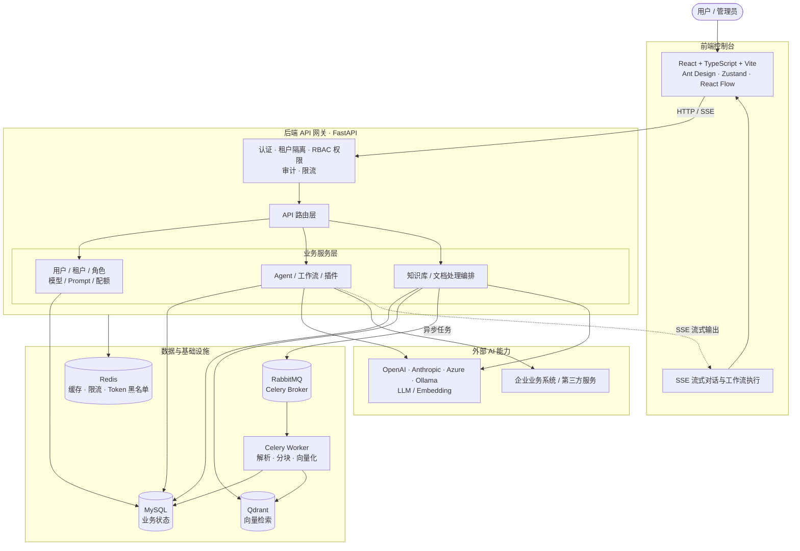
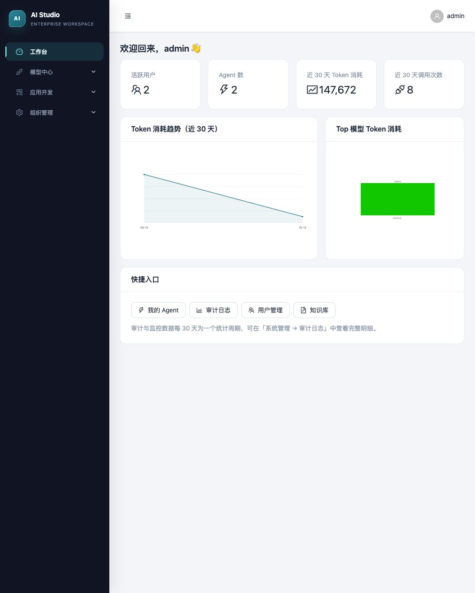
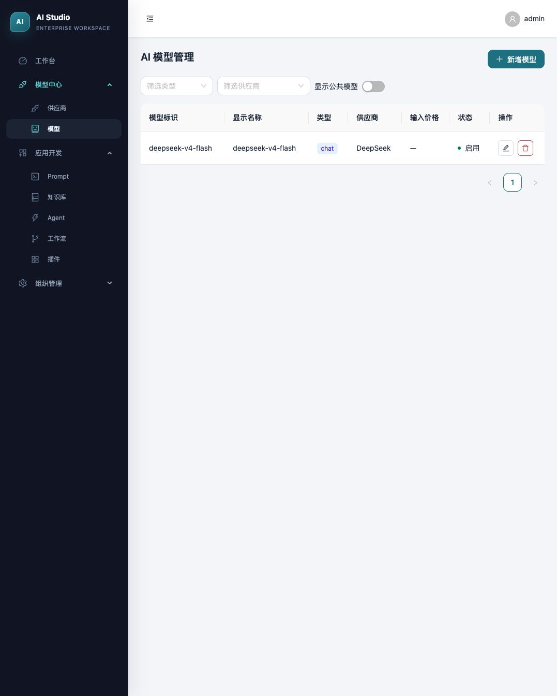
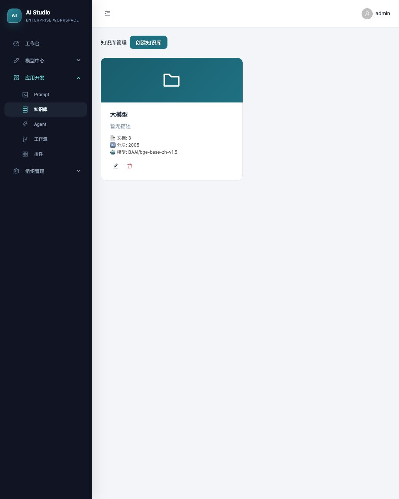
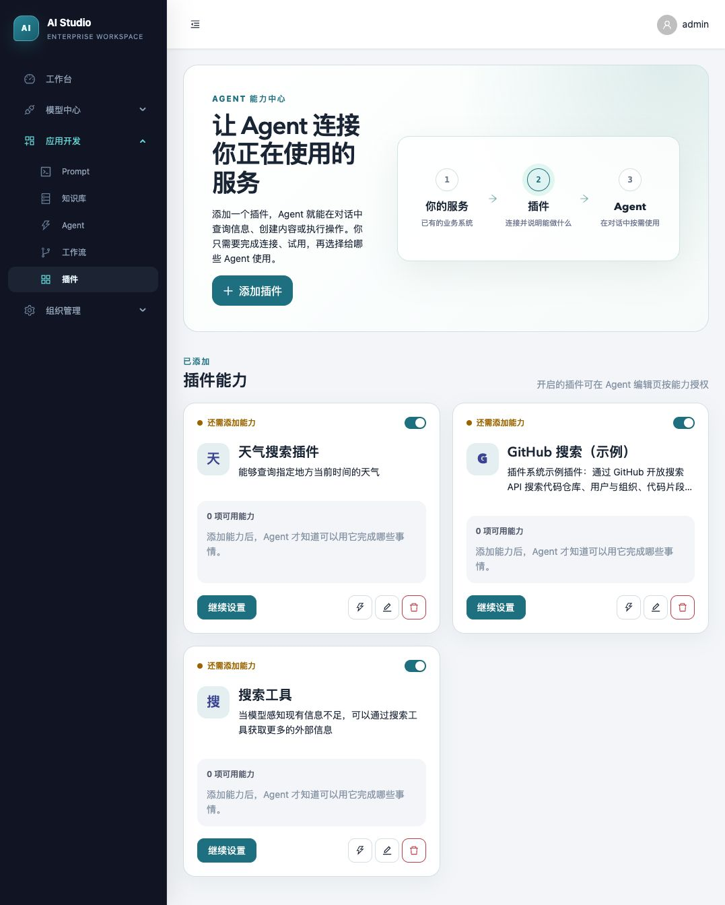
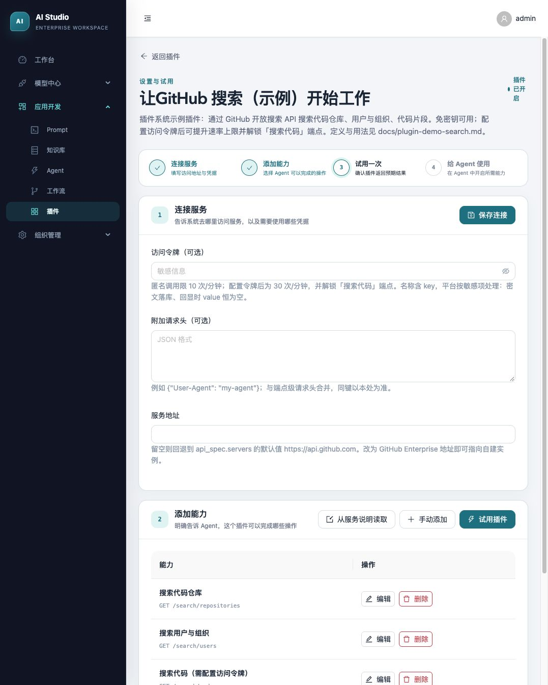
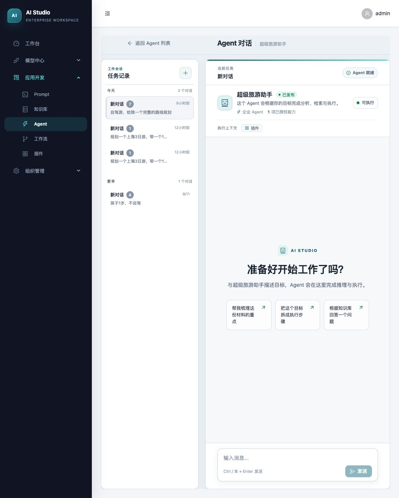
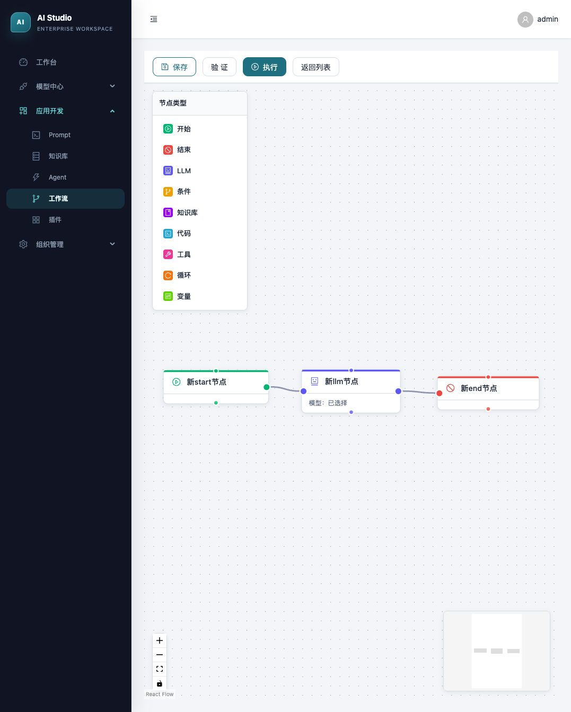

# AI-Studio

企业级 AI 应用平台 —— 在一个按工作任务组织的控制台中接入模型、沉淀知识、创建 Agent、连接业务服务并编排自动化工作流，同时以多租户与细粒度权限保障企业级安全。

---

## 为什么选择 AI-Studio

企业在落地 AI 时通常面临四道门槛：模型供应商碎片化、知识散落在各处、缺少可编排的自动化能力、以及难以在满足安全合规的前提下规模化推广。

AI-Studio 把这些能力收敛到一个平台：

- **一处接入，多家模型**：统一管理 OpenAI、Anthropic、Azure、Ollama 等供应商，API Key 双层加密，业务侧无需关心底层差异。
- **知识即服务**：把文档变成可语义检索的知识库，让大模型回答"有据可依"。
- **从对话到自动化**：既支持即问即答的 Agent，也支持可视化编排的 DAG 工作流，覆盖从探索到生产的全过程。
- **天生企业级**：多租户数据隔离、细粒度 RBAC、全量审计与配额管控，开箱即用。

---

## 核心业务能力

| 能力 | 说明 | 业务价值 |
|------|------|----------|
| **多租户隔离** | 数据层按租户过滤，从根本防止跨租户数据泄漏 | 一套平台安全服务多个团队/客户 |
| **统一模型管理** | 集中接入多家 AI 供应商，API Key 加密存储，支持连通性测试 | 避免供应商锁定，统一治理成本与密钥 |
| **知识库（RAG）** | 文档上传 → 解析分块 → 向量化 → 语义检索 | 让回答基于企业私有知识，降低幻觉 |
| **智能 Agent** | ReAct 推理 + 工具绑定 + SSE 流式对话 + Markdown 渲染 | 像同事一样持续对话并调用工具完成任务 |
| **可视化工作流** | 拖拽式 DAG 编辑器（React Flow），LLM/条件/知识库/代码/工具/循环节点 | 把重复流程固化成可复用的自动化管线 |
| **插件能力中心** | 通过“添加插件 → 连接服务 → 添加能力 → 试用 → Agent 授权”接入第三方服务 | 无需理解协议细节，也能让 Agent 安全使用已有业务系统 |
| **监控审计与配额** | 全量审计日志、Token 用量统计、调用监控、资源配额 | 用量可控、行为可追溯、合规可证明 |

## 整体架构

AI-Studio 采用前后端分离架构：前端通过 HTTP / SSE 访问 FastAPI API 网关，业务服务统一处理认证、租户隔离、权限、审计与配额；MySQL 保存业务状态，Qdrant 提供向量检索，Redis 负责缓存与限流，RabbitMQ + Celery Worker 承担文档解析、向量化等异步任务。



架构细节与关键技术决策见 [系统架构设计](docs/architecture.md)。

---

## 新版工作台

新版界面不再按技术模块平铺所有菜单，而是按照实际工作过程分区：

- **工作台**：查看活跃用户、Agent 数量、Token 消耗、调用趋势与常用入口。
- **模型中心**：统一管理供应商和模型连接。
- **应用开发**：集中使用 Prompt、知识库、Agent、工作流和插件。
- **组织管理**：管理用户、角色权限、审计日志与租户设置。
- **平台管理**：平台管理员使用独立的租户管理入口，不进入租户业务页面。

租户成员只会看到被授权的应用能力；租户管理员负责模型、插件和组织配置；平台管理员仅负责租户开通。详情页、编辑页、对话页和执行页均提供明确的模块归属与返回入口，避免在多层页面之间迷失。



*工作台把常用数据和入口集中在一页，登录后即可判断当前使用情况并进入下一项工作。*

### 统一模型接入

在“模型中心”集中维护供应商与模型。管理员只需填写服务地址与访问密钥、测试连接，再把可用模型交给 Agent 或工作流使用；API Key 加密保存，业务使用者不需要接触密钥。



### 知识库

知识库列表以卡片展示用途、文档数量和处理状态。进入详情后可以上传文档、查看解析结果、管理分块，并直接进行语义检索验证。普通成员可以使用已授权知识库，管理操作仅对管理员开放。



### 插件：让 Agent 连接业务服务

插件页面以“能帮助 Agent 做什么”为核心，而不是先展示协议和请求参数。使用流程如下：

1. **添加插件**：填写服务名称以及它能完成的事情。
2. **连接服务**：填写服务地址、访问密钥；额外请求头和特殊配置按需展开。
3. **添加能力**：从服务说明读取，或手动添加可执行操作。
4. **试用插件**：输入示例参数，确认连接和返回结果正常。
5. **给 Agent 使用**：在 Agent 编辑页选择允许使用的具体能力；未选择的操作不会暴露给 Agent，高风险操作需要单独确认。

插件列表会直接显示“还需添加能力”“可以给 Agent 使用”或“已暂停”等状态，并给出下一步操作。HTTP 方法、服务路径和原始 JSON 等信息仍可在高级设置中查看，但不会干扰主流程。





### Agent 设计与对话

创建 Agent 时选择模型、编写角色说明，并按“插件 → 具体能力”的粒度授权工具。对话工作台包含任务记录、当前执行状态、常用开场问题、流式回答和停止生成；知识库回答可展示引用来源，便于核验。



### 可视化工作流

基于 React Flow 的拖拽式画布提供开始、结束、LLM、条件、知识库、代码、工具、循环、输入和输出节点。节点配置直接选择已部署模型和知识库，并支持保存、校验、发布、执行及查看节点级结果。

LLM 节点可选绑定多个插件能力。启用后，模型会在安全轮数内自主发起工具调用，工作流执行插件并通过原生工具消息回传结果，模型可根据结果继续调用其他工具或生成最终答案；不绑定工具时仍按普通单次 LLM 节点执行。固定工具节点则适合必须调用一次的确定性流程。



### 组织与治理

租户管理员可以在“组织管理”中创建成员、分配角色权限、查看审计日志和调整租户设置。平台管理员使用独立页面创建租户和首位租户管理员，平台权限与租户业务权限保持分离。

---

## 典型应用场景

- **企业知识助手**：将制度、产品手册、FAQ 接入知识库，员工用自然语言即刻获取准确答案。
- **自动化业务工作流**：用 DAG 把"接收表单 → 调用模型生成 → 检索知识库核验 → 写入业务系统"串成一条自动化流水线。
- **内部 Agent 中台**：为不同部门快速搭建专属 Agent，统一在平台上管理模型、权限与配额。
- **合规审计场景**：借助多租户隔离与全量审计日志，满足金融、政企等对数据隔离与操作留痕的硬性要求。

---

## 快速体验

项目支持多种部署方式。快速体验推荐使用 Docker Compose 一键拉起全部依赖与前后端服务（MySQL、Redis、RabbitMQ、Qdrant、后端 API、Celery Worker、前端 Nginx）：

```bash
cp .env.example .env      # 按需修改密码与密钥
docker compose up -d --build
```

Redis 仅承担缓存、限流和 Token 黑名单；Celery 任务通过 RabbitMQ 的持久 quorum queue 投递，任务业务状态写入 MySQL。

开发时可直接启动 Compose Watch；后端和 Celery 代码会同步重启，依赖或前端源码变化会自动重建对应镜像：

```bash
docker compose watch
```

启动后访问前端控制台 `http://localhost:80`。平台管理员创建租户并开通首位租户管理员账号；租户管理员再创建成员账号并配置模型与业务权限。

如果已有 Kubernetes 集群，也可以使用项目提供的可选 K8s 部署方案：

```bash
./deploy/k8s/one-click-deploy.sh
```

新增脚本会把项目上传到部署服务器，再在服务器上执行原有的镜像构建/导入和集群部署脚本。已完成镜像导入时可使用 `./deploy/k8s/one-click-deploy.sh --skip-build`，也可分别执行 `build`、`deploy` 和 `status` 子命令。原有 `deploy/k8s/build-images.sh` 与 `deploy/k8s/deploy.sh` 保持不变。Kubernetes 清单、服务器要求和运维命令见 [deploy/k8s/README.md](deploy/k8s/README.md)。

> 完整的环境要求、本地开发启动、环境变量说明与运维命令，请查阅 [AGENTS.md](AGENTS.md)（技术架构与开发指南）。

---

## 了解更多

- **技术架构与开发指南**：[AGENTS.md](AGENTS.md)
- **编码约定（面向 AI 代理）**：[CLAUDE.md](CLAUDE.md)
- **设计文档**：[docs/](docs/)（系统架构、API 设计、数据库设计、核心机制、前端设计、实施计划）
- **在线 API 文档**：后端启动后访问 `http://localhost:8000/docs`（Swagger）与 `http://localhost:8000/redoc`（ReDoc）

---

## License

MIT
